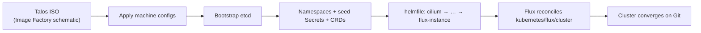

# Bootstrap

How the matalos cluster goes from bare machines to a Flux-managed cluster, and how to
rebuild it. Everything here is driven by [`bootstrap/`](../bootstrap),
[`talos/`](../talos), and the `just` recipes — there are no manual `helm install` steps.

## Design

The guiding principle is **one source of truth**. The bootstrap helmfile does not carry
its own chart versions or values; every release's chart URL, version, and values are
read at runtime from the _same_ files Flux reconciles later
(`kubernetes/apps/<ns>/<app>/app/ocirepository.yaml` + `helmrelease.yaml`, via
[`bootstrap/helmfile/templates/`](../bootstrap/helmfile/templates)). When Flux takes
over it adopts identical releases — zero drift, nothing to keep in sync.

Secrets follow the same rule: nothing secret is stored in `bootstrap/`. Manifests
contain `ref+op://` references that [`vals`](https://github.com/helmfile/vals) resolves
from 1Password at apply time using your local `op` session.



## Prerequisites

- **Toolchain:** `mise trust && mise install` (talosctl, kubectl, helmfile, kustomize,
  minijinja, vals, gum, just — all pinned in [`.mise/config.toml`](../.mise/config.toml)).
- **1Password:** an authenticated `op` session (or service account) that can read the
  `kubernetes` vault — vals resolves every `ref+op://` reference through it.
- **Network:** switch ports for the bare-metal nodes trunked (native VLAN 20, tagged
  70 + 90); DHCP or the static bond IPs reachable on `192.168.20.0/24`.
- **Machines:** boot media built for the right node type (below).

## Stage 0 — Machine preparation

Talos images come from the Image Factory, built from a schematic that selects system
extensions per node type. The shared
[`talos/schematic.yaml.j2`](../talos/schematic.yaml.j2) covers the bare-metal P330s
(`i915` + `mei` for the iGPU); the `matalos-c1` VM carries a complete override,
[`matalos-c1.schematic.yaml.j2`](../talos/nodes/controlplane/matalos-c1.schematic.yaml.j2),
with `qemu-guest-agent` instead. Both include `iscsi-tools`, `util-linux-tools`,
`intel-ucode`, and `nfsrahead`. Kernel args trade hardening for speed
(mitigations off, SELinux/AppArmor off) and enable IOMMU passthrough.

```sh
just talos download-image matalos-c2 v1.14.6 true   # bare metal: builds the schematic, fetches the ISO
just talos download-image matalos-c1 v1.14.6        # VM: no third argument
```

The version is the tag on `machine.install.image` in
[`talos/cluster.yaml.j2`](../talos/cluster.yaml.j2). Renovate bumps the example above in
the same PR as that pin (a regex manager in
[`.renovaterc.json5`](../.renovaterc.json5) matches the version on a `download-image`
line), but the template is the source of truth if the two ever disagree.

For bare-metal ISO boots the trailing `true` makes the schematic also inject
`bond=bond0:...:802.3ad` and a static `ip=` kernel arg, so a freshly booted node comes
up on its bonded VLAN-20 address and is immediately reachable in maintenance mode —
no console fiddling. The argument is positional and must be the bare word `true`:
without it, or written as `iso=true`, the ISO is built without those args. Boot each
machine from its ISO (PiKVM for the P330s, Proxmox for `matalos-c1`).

## Stage 1 — `just bootstrap cluster`

One confirmed command runs the whole pipeline. Its stages, in order
([`bootstrap/mod.just`](../bootstrap/mod.just)):

### 1. `nodes` — apply Talos machine configs

For every node in `talosconfig`: compose its machine config from three
layers ([`talos/cluster.yaml.j2`](../talos/cluster.yaml.j2) → role patch
[`talos/controlplane.yaml.j2`](../talos/controlplane.yaml.j2) → the node file
under [`talos/nodes/<role>/`](../talos/nodes) with install disk, links/bonds,
hostname), each rendered through minijinja + vals (secrets from 1Password)
and merged by `talosctl machineconfig patch` — see [`talos/README.md`](../talos/README.md) — then `talosctl apply-config --insecure`. Idempotent: a node that answers with
"certificate required" is already configured and is skipped.

### 2. `k8s` — bootstrap etcd

`talosctl bootstrap` against the first controller, retried until it reports
`AlreadyExists`. This is the only stage that creates cluster state.

### 3. `kubeconfig` (direct) — temporary API access

Fetches the kubeconfig (context `main`) but pins the server to a **node IP**: the
normal API endpoint (`matalos.internal` → the `192.168.10.20` VIP) is a Cilium BGP
LoadBalancer that doesn't exist yet.

### 4. `base` — namespaces, seed secrets, CRDs

Waits until nodes register (they sit at `Ready=False` — expected, there's no CNI yet),
then applies two things:

- **[`bootstrap/kustomize/apps/`](../bootstrap/kustomize/apps)** — the `flux-system`,
  `network`, and `security` namespaces (annotated
  `kustomize.toolkit.fluxcd.io/prune: disabled` so Flux never garbage-collects them)
  plus the three **seed Secrets**, rendered through vals:
    - `onepassword-connect-credentials-secret` + `onepassword-connect-vault-secret`
      (security) — break the chicken-and-egg: External Secrets needs 1Password Connect,
      and Connect needs its credentials. These two are the only secrets ever injected
      from a workstation; everything else is an `ExternalSecret`.
    - `cloudflare-tunnel-id-secret` (network) — the tunnel ID for cloudflared.
- **CRDs** — [`bootstrap/helmfile/crds.yaml`](../bootstrap/helmfile/crds.yaml) renders
  (never installs) envoy-gateway, grafana-operator, kopiur, prometheus-operator-crds, and
  snapshot-controller with `--include-crds` and pipes only the
  `CustomResourceDefinition` documents to `kubectl apply`. Installing CRDs out-of-band means Flux Kustomizations that _consume_
  CRD-backed resources (HTTPRoutes, ServiceMonitors, dashboards) don't all need
  `dependsOn` chains to the operator that ships the CRD.

### 5. `apps` — the core runtime, in dependency order

`helmfile sync` on [`bootstrap/helmfile/apps.yaml`](../bootstrap/helmfile/apps.yaml)
(each release `needs` the previous one):

| #   | Release                            | Why it's in the chain                                                                                                                                                                             |
| :-- | :--------------------------------- | :------------------------------------------------------------------------------------------------------------------------------------------------------------------------------------------------ |
| 1   | **cilium** (kube-system)           | CNI — nodes go `Ready`. Post-sync hooks wait for the BGP CRDs, then apply the app's own `networks.yaml` (BGP peering to the UDM Pro + the LB IP pool), which brings the `192.168.10.x` VIPs alive |
| 2   | **coredns** (kube-system)          | Cluster DNS                                                                                                                                                                                       |
| 3   | **spegel** (kube-system)           | P2P registry mirror before the image-pull storm                                                                                                                                                   |
| 4   | **cert-manager** (security)        | Post-sync hook applies the ClusterIssuers                                                                                                                                                         |
| 5   | **external-secrets** (security)    | ESO operator                                                                                                                                                                                      |
| 6   | **onepassword-connect** (security) | Consumes the seed Secrets; from here `ExternalSecret`s work                                                                                                                                       |
| 7   | **flux-operator** (flux-system)    | Flux lifecycle manager                                                                                                                                                                            |
| 8   | **flux-instance** (flux-system)    | The `FluxInstance`: GitRepository `https://github.com/materia-ops/home-ops.git`, path `kubernetes/flux/cluster`                                                                                   |

### 6. `kubeconfig` (final)

Re-fetches the kubeconfig pointed at the real API endpoint, now that Cilium is
announcing the VIP.

Both `kubeconfig` stages write to a gitignored `kubeconfig` file in the repo root, and
the bootstrap module exports `KUBECONFIG` pointing at it, so every stage talks to the
cluster being built, never to whatever kubeconfig the shell had. It is a bootstrap
artifact, not the day-to-day credential: routine cluster access uses a kubeconfig
obtained through 1Password (see
[repo-workflow.md](./repo-workflow.md#environment-setup)).

### 7. `handover`

Logs a warning naming that file: it is a plaintext admin credential. Store it in your
secret manager, then delete it. Until you have, pass it explicitly
(`KUBECONFIG=./kubeconfig kubectl …`): outside the bootstrap recipes nothing points at
it, since mise sets neither `KUBECONFIG` nor `TALOSCONFIG` and `kubectl` uses the
shell's own.

## Stage 2 — Handoff to Flux

The moment the `FluxInstance` is ready, Flux clones `main`, applies
[`kubernetes/flux/cluster/ks.yaml`](../kubernetes/flux/cluster/ks.yaml), and reconciles
everything under `kubernetes/apps/` — including the eight bootstrap releases, which it
adopts cleanly because helmfile installed them from the very same values. Stateful apps
with the `kopiur/backup` component have their PVC populated by a kopiur `Restore` as it is
provisioned, so **application data restores automatically from the Kopia repository on the
NAS** during a rebuild.

Bootstrap artifacts are never touched again; day-2 changes all flow through Git
(see [repo-workflow.md](./repo-workflow.md)).

## Verification

```sh
cilium status                      # CNI + BGP healthy
kubectl get nodes                  # all Ready
flux check && flux get ks -A       # Flux reconciling, everything Ready
kubectl -n rook-ceph get cephcluster   # HEALTH_OK once storage converges
dig @192.168.1.2 <app>.materia.wtf     # Pi-hole has the internal records
```

Expect 10–20 minutes of churn while Flux works through dependency ordering — transient
`dependency not ready` messages are normal.

## Reset / rebuild

```sh
just talos reset-node matalos-c2       # per node, confirmed
```

`reset-node` wipes the `STATE`, `EPHEMERAL`, and `u-local-hostpath` partitions —
i.e. the OS, cluster state, and OpenEBS hostpath volumes — and drops the node back to
maintenance mode. Note:

- **Ceph OSDs are not wiped** by the reset. For a genuine from-scratch rebuild, zap the
  Micron 7450s separately (or let Rook re-adopt the existing cluster — decide _before_
  you bootstrap).
- App data is recoverable regardless via kopiur/Kopia from the NAS.
- Repeated rebuilds in a short window can hit Docker Hub / Let's Encrypt rate limits;
  Spegel only helps while at least one node still has the images.
