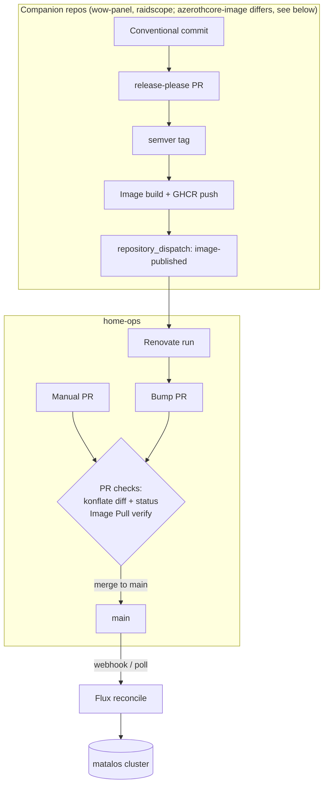

# CI/CD

Everything that runs between "a change exists" and "the cluster runs it". The
contributor-facing view (what _you_ must do to keep this green) is in
[repo-workflow.md](./repo-workflow.md).

## The big picture

There are two deployment paths, both converging on Flux:



Nothing deploys from CI directly — CI only validates; **Flux is the only deployer**.

## Runners

Two runner types:

- **GitHub-hosted (`ubuntu-latest`)** for anything that doesn't need LAN access.
- **Self-hosted (`home-ops-runner`)** — Actions Runner Controller (ARC) in the
  `actions-runner-ansible` namespace, min 0 / max 3, autoscaling per queued job (scale
  from zero). These runners are _inside_ the cluster, which is what lets CI run Ansible
  against the Pis (egress allows only `:22` to the managed hosts). Only the Ansible job
  (`ansible.yaml`) uses them, and they hold **no Talos credential**. Until 2026-11 a
  Talos `os:admin` mount served the image pre-pull, and any same-repo branch could have
  reached it.
- **Self-hosted (`azerothcore-image-runner`)** — the rootless BuildKit builder for the
  azerothcore-image repo, including its PR trial builds. It runs alone in the
  `actions-runner-azerothcore` namespace with no Kubernetes API token, egress limited to
  DNS and public 80/443, and no github-bot key in the namespace. No container in the pod
  is privileged: `buildkitd` runs as uid 1000 in a user namespace, with seccomp
  `Unconfined` because rootless BuildKit needs it.

CI secrets follow the same 1Password-first model as the cluster. Workflows load
credentials with `OP_CI_SERVICE_ACCOUNT_TOKEN`, which belongs to the 1Password service
account `gh-actions-ci-ro` (read-only, `ci` vault). Anything that needs to write to
GitHub mints a short-lived **github-bot App token** from the key in `ci`. "github-bot" is
the name of that 1Password item; the GitHub App itself is `materia-minion`, so its PRs
and comments are authored by `materia-minion[bot]`. That token must
carry `workflows: write` for release automation in the companion repos. The Ansible job
uses its own, [Environment-scoped](#credentials-and-host-keys) token.

**No workflow that runs a branch's code can read 1Password.** `OP_CI_SERVICE_ACCOUNT_TOKEN`
exists only as a secret on each repo's `ci-main` GitHub Environment, and its
deployment rule admits `main` alone. In materia-core and wow-panel it also admits their
release tags. Org and repo secrets reach any branch push or same-repo PR. Environment
secrets reach only a job that names the Environment, and only when the run's ref matches
its rule. Without this, a branch could add a workflow that reads the github-bot key and
self-merge. A typical route would be a Renovate PR carrying a compromised upstream
action. So:

- Jobs that run from `main` (pushes, schedules, dispatches) declare
  `environment: ci-main`.
- PR-time jobs that need `ci` use `pull_request_target`. That runs **main's** copy of the
  workflow, on the base ref, so `ci-main` admits it. The PR contributes only data, never
  code to execute: claude-review and the Renovate canary below.
- Everything else on `pull_request` uses `GITHUB_TOKEN` only, labeler for example.

## Workflows in this repo

### `image-pull.yaml` — verify changed images on PRs

On every PR touching `kubernetes/**`: [flate](https://github.com/home-operations/flate)
diffs the rendered Flux state between the PR and main and extracts the _changed_ image
references. A matrix job on GitHub-hosted runners then checks that each one resolves
(`docker manifest inspect`, anonymous, with retries). A typo'd tag or digest fails the
PR instead of the rollout.

The job used to `talosctl image pull` each image onto the nodes from the self-hosted
runner, to pre-warm them. That needed a Talos `os:admin` credential on a runner any
same-repo branch could target, so it was retired in 2026-11. Spegel's P2P mirror covers
most of the warm-up: only the first node to pull a new image waits on the registry.

Private `ghcr.io/materia-ops/*` images are filtered out: the check runs anonymously
(they pull fine at pod start via `ghcr-pull-secret`). (The filter also covered `ghcr.io/malpractis/*`
during the [GHCR namespace migration](#ghcr-namespace-migration-malpractis--materia-ops);
that prefix was dropped once nothing referenced it.)

### `renovate.yaml` — dependency automation

Self-hosted Renovate run, triggered by:

- an hourly schedule (`20 * * * *`),
- config changes (`.renovaterc.json5`, `.renovate/**`),
- manual dispatch (with dry-run/log-level/version inputs),
- **`repository_dispatch: image-published`** — fired by the companion repos the moment
  they publish an image, so bump PRs open immediately instead of waiting for the
  schedule.

Auto-merge policy (see [`.renovaterc.json5`](../.renovaterc.json5)): mise tools
(minor/patch, 3-day cooldown), GitHub Actions (minor/patch/digest), trusted
`home-operations` digests, the raidscope/wow-panel images (semver from
release-please), Grafana dashboards, and Renovate preset bumps (minor/patch) — all via
PR automerge (the org ruleset forbids direct branch pushes). The AzerothCore server
image, MySQL, the kopiur chart, CNPG Postgres and the TimescaleDB operand are
explicitly never auto-merged; everything else waits for review. The config file is the
full list.

The Renovate runner pin (`RUNNER_VERSION` in the workflow) is the one
self-update Renovate cannot recover from on its own, so it auto-merges only after
a 1-day soak (tracked as a GitHub release: GHCR carries no release timestamps),
and a PR that moves it is **canaried**, and the automerge waits for the canary.

The canary runs on `pull_request_target`, so it is main's copy of the workflow
under `ci-main`. It takes only the candidate version from the PR head, read through
the API and accepted only as a bare `X.Y.Z`. It runs that image as a full dry run
with a read-only App token. Such a run's own check lands on main's commit, which
Renovate's merge gate never reads. The verdict therefore goes on the PR head as a
**`Renovate canary`** commit status: pending from the job's first step, then
success, failure or error. Before every run the image's keyless signature is verified against
Renovate's own build workflow identity, since the soak does nothing against a
re-pushed tag. Two guards make a bad runner loud instead of silent
([#1681](https://github.com/materia-ops/home-ops/pull/1681)): `NODE_OPTIONS`
strict mode turns a startup crash into a red **Run Renovate** step, and **Assert
every repository finished** reads Renovate's log and fails the run when any
repository in the autodiscover list is missing from it or aborted hard —
transient or by-design results (a PR merged under the run, a paused repository)
only warn. A failed scheduled or dispatched run pages Pushover directly from the
workflow within seconds (`op://ci/pushover`); the gatus `ci` dead-man remains
for the case a disabled schedule never runs at all. To trial a newer runner by
hand, dispatch the workflow with the `version` input; the runbook is in
[operations.md](operations.md#known-failure-modes-and-their-runbooks).

### `ansible.yaml` — infrastructure configuration

Configures the hosts outside the cluster from `infrastructure/`: the two Pi-holes
(`pi-0`, `pi-1`: networking, dnscrypt-proxy, Pi-hole) and the Proxmox host `pve-0`
(unattended upgrades), plus the observability play (node and smartctl exporters) on
every host.

The toolchain (Python, `ansible-core`, the Galaxy collections, `op`) is baked into a
job image built from `infrastructure/Dockerfile` and published to the **private** GHCR
package `ghcr.io/materia-ops/home-ops-ansible`. The tag is the first 16 hex characters
of a hash of the Dockerfile, `requirements.txt` and `requirements.yaml`, so the image is
rebuilt only when one of those changes:

- `<hash16>` — built by `main`'s own run of this workflow, with a build-provenance
  attestation. `main` reuses an existing tag only after `gh attestation verify` proves
  it was built on `refs/heads/main`. Any ref with `packages: write` can overwrite a tag,
  so a tag without that attestation is rebuilt.
- `dev-<hash16>` — built by a dispatch on any other ref. It is not attested, and `main`
  never reads it.

Nothing prunes old tags yet, so every input change leaves its previous image (and its
attestation) behind in the package.

PRs run a credential-less **Validate** on a GitHub-hosted runner. When the image inputs
are unchanged, it pulls the published `<hash16>` image. When they changed, or for a
fork without GHCR access, it builds the image locally (unpushed). It then syntax-checks
the playbook in the image. The self-hosted job is gated off the `pull_request` path
entirely. On push to `main` (and manual dispatch):

1. **Image** — on a GitHub-hosted runner, reuses the tag if it exists (and, on `main`,
   is attested), otherwise builds, pushes and attests it, and hands on the
   digest-pinned `tag@sha256` reference.
2. **Plan** — in parallel with Image, on a GitHub-hosted runner; derives `--tags` from changed paths (`roles/dnscrypt_proxy/` → `dnscrypt`, `roles/network/` → `network`,
   `roles/pihole/` or `talos/nodes/` → `pihole`, `roles/unattended_upgrades/` → `unattended_upgrades`,
   `inventory/group_vars/` → `observability`, structural files (playbook, `inventory/hosts.yaml`,
   requirements, `ansible.cfg`, Dockerfile, `known_hosts`) → everything). On push, the diff runs from
   the commit of the **last successful push run on `main`**, not from the push's own
   `before`, so a cancelled or failed run's changes fold into the next one; with no
   usable diff (no earlier success, an unexpected compare result, the 300-file API cap,
   an API error) it runs everything. A dispatch takes its `tags` input verbatim, and a
   blank value means everything.
3. **Check + Apply** — one job on the self-hosted runner (LAN access to the hosts),
   running in the job image, so a run pays for one runner cold start and no installs:
   `ansible-playbook --check --diff` against the live hosts, then Apply if Check passed,
   on push to `main` (or manual dispatch on `main` with `check_only=false`). Check and
   Apply are steps of the same job, so **re-running a failed Apply re-runs Check too**.
   A failed Check never reaches Apply.

Only one run touches the hosts at a time: the Check + Apply job sits in a single
`ansible-hosts` concurrency group shared by every event and branch, check-only
dispatches included. GitHub keeps one running and one pending job per group, and a
third arrival cancels the pending one. That cancellation loses nothing, because the
next push run diffs from the last successful Apply; to apply a cancelled push sooner,
**Re-run all jobs** on it. Before Check, an Apply-capable run (push, or a `main`
dispatch with `check_only=false`) fails if its commit is behind the last successful
push run, so rerunning an old run, or a run that reached the group after a newer one,
cannot roll the hosts back. [`.github/scripts/ansible_last_applied.py`](../.github/scripts/ansible_last_applied.py)
does that lookup for both Plan and this guard.

The network, dnscrypt and pihole plays are `serial: 1` + `any_errors_fatal` with a
verification between hosts (the interface still connected; a DNS resolve; the web UI
answering on its ingress hostname), so a bad change can only take out one Pi-hole before
the rollout stops.

**Dependency updates.** `requirements.in` pins `ansible-core`. Renovate's `pip-compile`
manager bumps that pin and regenerates `requirements.txt`, a `uv pip compile
--generate-hashes` lock that pip installs with `--require-hashes`. The plain
`pip_requirements` manager is disabled for the lock, because it would bump the
transitive pins without regenerating their hashes. Lock maintenance runs monthly
(first of the month) to pick up transitive fixes. Every image input (the Dockerfile's
base images, both requirements files) is grouped into one **ansible job image** PR,
opened weekly before 6am Monday, because each image change triggers a full Apply on
merge.

**Coupled holds.** Two `allowedVersions` holds in `.renovaterc.json5` keep the image on
a working combination:

- **`ansible-core` < 2.22.** prometheus.prometheus 0.30.x declares
  `requires_ansible: ">=2.14.0,<=2.21.99"` in its `meta/runtime.yml`.
- **Python < 3.15** (the Dockerfile's `python` base image). ansible-core 2.21 crashes
  on import under 3.15, because `dataclasses._is_type` was removed.

The Python hold exists only because of the ansible-core one, so the two lift together.
The trigger is a prometheus.prometheus release whose `requires_ansible` admits 2.22.
Every prometheus.prometheus bump PR carries a note to check that field. When it does
admit 2.22, one PR removes both holds and bumps `--python-version` in the
`requirements.txt` uv header, which Renovate's regeneration otherwise keeps at 3.14.

#### Credentials and host keys

Check + Apply holds root-equivalent SSH to every host, so it does not use the general
CI token (`OP_CI_SERVICE_ACCOUNT_TOKEN`). Its token, `OP_INFRA_SERVICE_ACCOUNT_TOKEN`, belongs to a
dedicated service account that reads only the `infrastructure` vault (the `ansible` SSH
key, the `dnscrypt` stamps) and `pihole`, and it exists only as a secret on two GitHub
Environments:

- **`infrastructure`** — deployment branches: `main` only, no reviewers. Push-to-main
  Check + Apply runs unattended.
- **`infrastructure-preview`** — any branch, required reviewer. A `check_only` dispatch
  from a branch (to dry-run a workflow or role change against the live hosts before
  merge) waits for approval. Read the branch diff before approving: the branch's own
  workflow file runs with the token, so the approval is the control, not the
  `ref == main` guard on Apply. A run left waiting still sits in the `ansible-hosts`
  concurrency group, so main's Check + Apply queues behind it: approve it, or reject or
  cancel it, rather than leaving it pending.

The job picks the Environment from `github.ref`. A workflow on any other branch or PR
that names the secret gets nothing without passing one of these gates.

Host keys are pinned in [`infrastructure/known_hosts`](../infrastructure/known_hosts)
with `StrictHostKeyChecking=yes`, keyed by inventory name through `HostKeyAlias`, so a
DNS answer or IP change never alters which key is trusted. A rebuilt or reflashed host
generates new keys and its plays fail with "Host key verification failed" until the
file is updated:

1. On the host's console (not over the network), read the new key:
   `cat /etc/ssh/ssh_host_ed25519_key.pub` and `ssh-keygen -lf` it for the fingerprint.
2. Replace that host's line in `infrastructure/known_hosts` (`<inventory-name> ssh-ed25519 <key>`)
   and open a PR. Merging it re-runs every play.

A key mismatch on a host that was _not_ rebuilt is an incident, not a chore. Don't
update the file to make CI green until the cause is understood.

### `tag.yaml` — monthly repo tag

Monthly (or manual) date-based tag on `main` via the github-bot App, giving coarse
restore points for the whole cluster state.

### `labeler.yaml` — housekeeping

Auto-labels PRs by touched area (`.github/labeler.yaml`). It runs on `pull_request`
with `GITHUB_TOKEN` only, so it holds no 1Password token. The label set itself is not
defined here: the org-wide label sync in
[`materia-ops/.github`](https://github.com/materia-ops/.github) owns it for every
repository, so a new label is added to its `labels.yaml`.

### `label-sync-watchdog.yaml` — is the org label sync still running

Daily (or manual) call of the report-only reusable watchdog in `materia-ops/.github`.
It opens one issue here when that repo's nightly label sync is disabled or has not
succeeded for more than three days. The schedule lives in this repo because GitHub
disables schedules in a public repo after 60 days without activity, and that one is quiet.

### `claude-review.yaml` — report-only PR review

Runs [claude-code-action](https://github.com/anthropics/claude-code-action) on every
same-repo, non-draft PR and posts **one** top-level comment (verdict, breaking changes,
deprecations, problems, features worth adopting, sources) plus inline anchors for
concrete problems. For dependency bumps it walks every release between old and new
and maps findings against what this repo actually configures; for everything else it
checks manifests, Flux wiring and CLAUDE.md conventions. It is report-only (L1): it
never approves, requests changes or merges, and its tool allowlist is read-only plus
`gh pr view|diff|comment` and `gh release list|view`.

It runs on `pull_request_target`, so main's copy of the workflow holds the credentials
under `ci-main`. It loads only `op://ci/claude/CLAUDE_CODE_OAUTH_TOKEN` and comments
with `GITHUB_TOKEN`; the github-bot key never enters it. The workspace root is main's
tree, so CLAUDE.md, `.claude/` settings and the evidence script are never the PR's. The
PR head is checked out under `_pr/` as data for the model to read. A same-repo guard
keeps forks out. The prompt treats PR bodies and changelogs as untrusted data.
Residual risk: a prompt injection in a PR could leak the Claude token.

Before the model runs, an **upgrade-evidence** step collects the release notes
deterministically instead of leaving the research to the model.
[`.github/scripts/upgrade_evidence.py`](../.github/scripts/upgrade_evidence.py) reads
the PR diff, finds every version change (OCIRepository chart tags, HelmRelease image
tags, single-line `image:`/`imageName:` references, `# renovate:` annotated pins, Talos
installer images, `.mise/config.toml` pins, pinned `uses:` actions), and cross-checks
them against the Renovate table and title. Image flavour suffixes
(`18.6-standard-bookworm`) are dropped when comparing a tag against release versions.
For a chart bump it also reads `appVersion` from both chart versions with
`helm show chart` and adds the **inner application** as its own row. That is where
breaking changes tend to hide: the external-dns 1.21→1.22 chart bump (#1728) shipped
the app's 0.22 annotation-prefix change, which was only in the app's release notes.
It resolves each dependency to an upstream repo (Renovate source link, then
[`evidence-sources.yaml`](../.github/scripts/evidence-sources.yaml) overrides, then the
chart's `sources`/`home`, charts-mirror metadata, the OCI `image.source` label, then
the `ghcr.io/<owner>/<repo>` pattern), and pulls the notes for **every** release in the
range from GitHub, Codeberg or GitLab releases, falling back to `CHANGELOG.md`. Its
Markdown output, `.review-evidence/upgrade-impact.md`, starts with a summary table and
labels rollbacks, digest-only rebuilds, and anything it could not resolve
(`UNRESOLVED`) or had to cut to fit its size caps (`truncated`). The prompt tells the
model to read this file first, cover every row, and go upstream itself only for those
gaps.

Trust model: the step runs with the read-only `github.token`, never the App token or
the 1Password secrets. It is `continue-on-error` with a 3-minute timeout, and the
script keeps its own time budget below that so it always writes a file, marking any
rows it did not reach as `UNRESOLVED`. If it fails anyway, the model researches
unaided. The script is checked out from the PR's **base** commit (`_base/`), so a PR
cannot change the code that gathers evidence about itself. The flip side is that a
change to the script only takes effect for PRs opened after it merges. The step
deletes `.review-evidence/` before writing, so a PR cannot plant a forged evidence
file. Release notes are third-party text: the file is labelled untrusted, HTML
comments are stripped, and code fences are neutralised so a note cannot break out of
its quoted block.

### `recyclarr-drift.yaml` — TRaSH Guides changes to review

The recyclarr configs use guide-backed profiles, so scores, default CF groups and
default CFs follow TRaSH on every sync without a config edit, and the configs list
only deliberate deviations. That makes upstream changes silent, and the optional ones
can never arrive on their own. Weekly (and on pushes that touch the configs or
baseline), [`.github/scripts/recyclarr_drift.py`](../.github/scripts/recyclarr_drift.py)
shallow-clones the TRaSH JSON, lists everything it offers each instance, and diffs that
against the reviewed baseline in `kubernetes/apps/media/arr-apps/recyclarr/drift-baseline.json`.
It reports new optional groups and CFs (a decision to make), default flips in either
direction (something started or stopped syncing), groups and CFs that left upstream,
and config problems: trash_ids that no longer exist, `select` entries the guide has
since made default or required, and a baseline older than the configs. Findings go to
a single open issue ("recyclarr: TRaSH Guides changes to review"), refreshed in place
and closed when clean. It is report-only (L1) and never edits the configs.

To clear the issue, decide each item in the config (`add`, `select`, `exclude`, `skip`),
then accept the rest and commit both:

```sh
python3 .github/scripts/recyclarr_drift.py --update-baseline
```

### `scripts-test.yaml` — script tests

Runs `python3 -m unittest discover -s .github/scripts/tests` on PRs touching
`.github/scripts/**`. The upgrade-evidence fixtures are real PRs (#1728, #1734,
#1761, #1917, #1924, #1953, #1955, #1965) with recorded API responses, so the suite runs
offline. Re-record a fixture with the command in the test module's docstring after a
deliberate behaviour change. The recyclarr-drift tests build a synthetic TRaSH tree in
a temp directory.

### `zizmor.yaml` — workflow security lint

Runs zizmor on pushes to `main` and PRs that
touch `.github/**`. It is report-only: findings are uploaded to code scanning as SARIF
and never fail the check. Fork PRs are skipped, because they cannot be granted
`security-events: write`.

### `renovate-lint.yaml` — Renovate config validation

On PRs that touch `.renovaterc.json5` (or the workflow itself), runs
`renovate-config-validator --strict` inside the same Renovate image `renovate.yaml`
executes. The two pins move together in the grouped runner-pin PR, so a new runner
version validates the config before it merges.

### `docs-lint.yaml` — stale links in the docs

On PRs that touch `docs/**`, `README.md` or `CONTRIBUTING.md`, rejects
`github.com/Malpractis` links (the org moved to `materia-ops`). This file is exempt: its
[GHCR migration](#ghcr-namespace-migration-malpractis--materia-ops) section keeps them
as history.

## konflate — PR gating and Flux visibility

[konflate](https://github.com/home-operations) runs **in-cluster** (`flux-system`
namespace) connected to `github://materia-ops/home-ops`:

- **PR status checks + diff comments** — renders the Flux state for each PR and posts
  what would change; this is the primary "will this do what I think" gate before merge.
- Serves a web UI at `konflate.materia.wtf` and refreshes state every 15 minutes.

## Flux delivery

- **Receiver webhook** — GitHub `push` events hit
  `flux-webhook.materia.wtf/hook/…` (through the Cloudflare Tunnel), so reconciliation
  starts seconds after merge; the 1 h poll interval is only a fallback. A Cloudflare
  WAF **Skip rule** above the "Block Non AU" geo-block whitelists the webhook paths —
  GitHub delivers from US IPs.
- **Alerts** — Flux notification-controller sends reconciliation errors to the
  in-cluster Alertmanager (→ Pushover), so a failed deploy pages without anyone
  watching CI.

## Companion repo pipelines

Application code lives in separate repos; home-ops only ever consumes their published
images by digest/semver. The pattern wow-panel and raidscope share:

1. Conventional Commits → **release-please** maintains a release PR
   (feat → minor, fix → patch, `feat!` → major).
2. A human merges the release PR → tag → image build → push to GHCR.
3. The publish job fires `repository_dispatch: image-published` at home-ops → Renovate
   opens (and for these repos auto-merges) the bump PR.

Per-repo notes:

- **azerothcore-image** — also release-please, but the gates sit elsewhere. Its release
  PR is mechanical and merged by its own workflow; the image is built first and the
  version tag is applied to it afterwards. The human gates are the build-input PR in
  that repo and the home-ops bump PR, which never auto-merges. Builds take ~1h50m, so
  PRs that change build inputs open as **draft** (zero builds), get marked ready for
  exactly **one trial build**, and merge only when green (merge _promotes_ the trial
  image by digest, ~3 min; merging mid-build causes a full rebuild). When `main` moves,
  merge `main` into the build-input PR branch (never rebase or force-push) and let one
  fresh trial run. ccache seeding cuts warm builds; `versions.json` is the single realm
  gate.
- **wow-panel / raidscope** — the release-please pattern above; release builds check out the
  **tag ref** (a past bug built from `github.sha` and shipped an empty release — fixed,
  but any broken release can be rebuilt via workflow dispatch from its tag ref).

## GHCR namespace migration (malpractis → materia-ops)

The GitHub org moved from `Malpractis` to `materia-ops` (2026-07-18). Git-side
references (the `FluxInstance` GitRepository URL, konflate's `github://` repo, the
Renovate org preset) point at `materia-ops`, and the **GHCR image move is complete** —
nothing in `kubernetes/` references `ghcr.io/malpractis/*` anymore.

How each old-namespace reference was resolved:

| Reference                                               | Where                                                                                                                     | Resolution                                                                                                                                                           |
| :------------------------------------------------------ | :------------------------------------------------------------------------------------------------------------------------ | :------------------------------------------------------------------------------------------------------------------------------------------------------------------- |
| `ghcr.io/malpractis/azerothcore-wotlk-playerbots`       | [`kubernetes/apps/games/azerothcore/app/helmrelease.yaml`](../kubernetes/apps/games/azerothcore/app/helmrelease.yaml)     | Moved to `ghcr.io/materia-ops/azerothcore-wotlk-playerbots` (1.5.1, the first release published under the org)                                                       |
| `ghcr.io/malpractis/*` comment                          | [`kubernetes/apps/games/azerothcore-db/app/pullsecret.yaml`](../kubernetes/apps/games/azerothcore-db/app/pullsecret.yaml) | Comment updated to `ghcr.io/materia-ops/*`; notes the pull PAT stays owned by the personal `malpractis` account                                                      |
| `ghcr.io/malpractis/raidscope` / `wlogs-parser` comment | [`kubernetes/apps/default/raidscope/app/helmrelease.yaml`](../kubernetes/apps/default/raidscope/app/helmrelease.yaml)     | Historical comment reworded to point here                                                                                                                            |
| `instance: Malpractis`                                  | `kubernetes/apps/torrents/qbitmanage/app/externalsecret.yaml`                                                             | Notifiarr instance label renamed to `Materia` (cosmetic); app has since been removed (replaced by qui)                                                               |
| GHCR host-rule username `malpractis`                    | [`.github/workflows/renovate.yaml`](../.github/workflows/renovate.yaml)                                                   | **Stays as-is** — this is the PAT-owning personal account (which still exists), not the org; the token authenticates against `ghcr.io` regardless of image namespace |
| Filter for **both** namespaces                          | [`.github/workflows/image-pull.yaml`](../.github/workflows/image-pull.yaml)                                               | Narrowed to `ghcr.io/materia-ops/` only — see [image-pull](#image-pullyaml--verify-changed-images-on-prs) above                                                      |

> [!NOTE]
> `github.com/Malpractis/...` links in old release notes, commit history, and this
> section are deliberate migration history. Everywhere else in the docs the
> [docs-lint workflow](../.github/workflows/docs-lint.yaml) rejects them.
