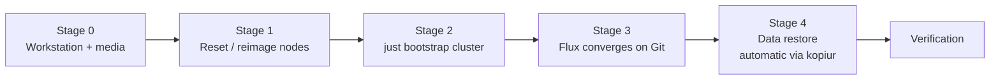

# Disaster Recovery

The total-loss runbook: every node down or wiped → cluster rebuilt → application data
restored. Nothing here is unique to a disaster — it is the normal
[bootstrap](./bootstrap.md) pipeline plus kopiur/Kopia restore, in order. Because the
whole cluster is declared in Git and every stateful app is snapshotted to the Kopia
repository on the NAS, the recovery inputs are: this repository, 1Password, and the NAS.



## Stage 0 — Workstation and prerequisites

Everything runs from a workstation checkout of this repo:

- **Toolchain:** `mise trust && mise install` (talosctl, kubectl, helmfile, kustomize,
  minijinja, vals, gum, just — pinned in [`.mise/config.toml`](../.mise/config.toml)).
- **Talos API identity:** a `talosconfig`, needed to reach the nodes at all. It lives
  only in 1Password (`talosconfig-matalos`, `kubernetes` vault) and is loaded
  just-in-time into `TALOSCONFIG` (tmpfs/temp file) — mise deliberately does not set it.
- **Local secret files** (gitignored, wired up by mise): the repo-local `kubeconfig`
  (re-fetched automatically during bootstrap) and `.secrets.env` (environment loaded
  by mise).
- **1Password:** an authenticated `op` session (or service account) that can read the
  `kubernetes` vault — `vals` resolves every `ref+op://` reference through it. The two
  1Password Connect seed secrets applied during bootstrap are the only secrets ever
  injected from a workstation.
- **NAS reachable:** the Kopia repository on the NAS is the restore source for all
  application data.
- **Network:** switch ports for the bare-metal nodes trunked (native VLAN 20, tagged
  70 + 90), so freshly booted nodes come up reachable on `192.168.20.0/24`.

If a machine needs reimaging, build its boot media first:

```sh
just talos download-image <node> <version>   # e.g. just talos download-image matalos-c2 v1.13.8
```

This renders the node's Image Factory schematic (system extensions, bond/VLAN kernel
args) and fetches the ISO — see [bootstrap.md](./bootstrap.md#stage-0--machine-preparation).

## Stage 1 — Reset or reimage the nodes

For nodes that are still running Talos, reset each one back to maintenance mode:

```sh
just talos reset-node <node>       # per node, confirmed
```

This wipes the `STATE`, `EPHEMERAL`, and `u-local-hostpath` partitions — OS
configuration, cluster state, and OpenEBS hostpath volumes. For dead or replaced
hardware, boot the ISO from Stage 0 instead (PiKVM for the P330s, Proxmox console for
`matalos-c1`); a fresh boot lands in maintenance mode ready for Stage 2.

> [!IMPORTANT]
> **Decide what happens to Ceph before you bootstrap.** `reset-node` does **not** wipe
> the Ceph OSDs (the Micron 7450s). Either zap them separately for a genuine
> from-scratch rebuild, or leave them intact and let Rook re-adopt the existing Ceph
> cluster — but decide _before_ running Stage 2. App data is recoverable either way via
> kopiur/Kopia from the NAS.

> [!NOTE]
> Repeated rebuilds in a short window can hit Docker Hub / Let's Encrypt rate limits;
> Spegel only mitigates image pulls while at least one node still has the images.

## Stage 2 — `just bootstrap cluster`

One confirmed command runs the whole day-0 pipeline
([`bootstrap/mod.just`](../bootstrap/mod.just)); it is idempotent, so a failed run can
simply be re-run:

| Stage                 | What it does                                                                                                                                         |
| :-------------------- | :--------------------------------------------------------------------------------------------------------------------------------------------------- |
| `nodes`               | Renders and applies each node's Talos machine config (`--insecure`, skips already-configured nodes)                                                  |
| `k8s`                 | `talosctl bootstrap` etcd on the first controller, retried until `AlreadyExists`                                                                     |
| `kubeconfig` (direct) | Fetches a kubeconfig pinned to a node IP (the API VIP doesn't exist until Cilium is up)                                                              |
| `base`                | Waits for nodes to register, applies namespaces + the three seed Secrets (via vals/1Password) + CRDs                                                 |
| `apps`                | `helmfile sync` of the core chain: cilium → coredns → spegel → cert-manager → external-secrets → onepassword-connect → flux-operator → flux-instance |
| `kubeconfig` (final)  | Re-fetches the kubeconfig against the real API endpoint, now announced by Cilium                                                                     |

Full detail per stage in [bootstrap.md](./bootstrap.md#stage-1--just-bootstrap-cluster).

## Stage 3 — Flux converges on Git

The moment the `FluxInstance` is ready, Flux clones `main` and reconciles everything
under `kubernetes/apps/` — adopting the eight bootstrap releases cleanly, since
helmfile installed them from the same values Flux uses. Expect 10–20 minutes of churn
while the dependency ordering works itself out; transient `dependency not ready`
messages are normal. To nudge it (or after fixing something):

```sh
just kube reconcile        # flux reconcile kustomization flux-system --with-source
```

## Stage 4 — Application data restore

**During a rebuild this is automatic.** Every stateful app that opts into the
`kopiur/backup` component gets a `Restore` populator that fills its PVC from the `materia`
repository (`nas.internal:/mnt/apps/kopiur`) as the PVC is provisioned, so application data
restores as part of Stage 3 — no per-app action needed.

For an app that needs a _manual_ restore afterwards (bad restore, or rolling a single
app back to an older snapshot):

```sh
just kube kopiur-restore <namespace> <app> [previous]
# previous defaults to 0 (latest snapshot)
```

The recipe ([`kubernetes/mod.just`](../kubernetes/mod.just)) suspends the app's Flux
Kustomization and HelmRelease, scales the workload to zero, runs a one-off kopiur `Restore`
into the live app PVC (`source.fromPolicy` at that offset, `target.pvcRef` on the PVC;
`previous` selects how many snapshots back), then resumes Flux and waits for the pod to
come back Ready. It refuses to restart the app unless the restore completed against a real
snapshot. To inspect data without restoring:

```sh
just kube browse-pvc <namespace> <claim>
```

> [!NOTE]
> **Legacy repository, retained until 2026-10-05.** Every app's kopiur history starts at
> its own migration in early September 2026; anything older lives only in the retired
> VolSync repository at `nas.internal:/mnt/apps/kopia`, which nothing in the cluster mounts
> any more. To reach it before it is deleted, run `kopia` against that path directly with
> the `volsync-template` 1Password password. Delete this note once the share is gone.

### Postgres (CloudNativePG)

CNPG clusters do not use kopiur. barman-cloud archives WAL and takes a daily base backup into
a per-app Garage bucket on the NAS (`garage.internal:3900`, `postgres-<app>-backup`), and the
restore procedure lives in [`components/cnpg/restore`](../kubernetes/components/cnpg/restore/kustomization.yaml).
Every cluster built from `components/cnpg/app` also pulls in
[`components/cnpg/b2-sync`](../kubernetes/components/cnpg/b2-sync/kustomization.yaml): an hourly
`postgres-<app>-b2-sync` CronJob that `rclone sync`s its archive to Backblaze B2
(`materia-cnpg/postgres-<app>-backup/`), encrypted client-side with rclone crypt (only file
contents; names stay readable, with a `.bin` suffix). The crypt password and salt live in the
`cnpg` 1Password item; **without them the B2 copy cannot be read**.
B2 keeps hidden (deleted or superseded) objects for 30 days.

**If Garage survived**, restore as normal: the B2 copy is not involved.

**If Garage is lost**, do not point CNPG at B2 directly. Restoring over the WAN was the reason
CNPG moved to Garage in the first place; it does not complete reliably. Instead, put the
archive back on the LAN first:

1. Suspend each `postgres-<app>-b2-sync` CronJob until step 3 is done. A missing or empty
   source prefix only fails the sync, but a partly-copied one would hide up to
   `--max-delete` B2 objects:
   `flux suspend hr postgres-<app>-b2-sync -n <ns>`, then
   `kubectl patch cronjob postgres-<app>-b2-sync -n <ns> -p '{"spec":{"suspend":true}}'`.
2. Rebuild Garage, create `postgres-<app>-backup` with an owner key for barman (update the
   `cnpg` 1Password item's `s3-key-id` / `s3-secret-key` if it is a new key) and the
   read-only `matalos-cnpg-ro` grant (see the comment in
   [`components/cnpg/app/objectstore.yaml`](../kubernetes/components/cnpg/app/objectstore.yaml)).
3. Copy the archive back with rclone. The remotes are defined by environment variables, the
   same ones the CronJob uses, with keys resolved just-in-time by `op run` from an env file:

    ```sh
    RCLONE_CONFIG_B2CRYPT_TYPE=crypt
    RCLONE_CONFIG_B2CRYPT_REMOTE=b2:materia-cnpg
    RCLONE_CONFIG_B2CRYPT_FILENAME_ENCRYPTION=off
    RCLONE_CONFIG_B2CRYPT_DIRECTORY_NAME_ENCRYPTION=false
    RCLONE_CONFIG_B2CRYPT_PASSWORD=op://kubernetes/cnpg/b2-crypt-password
    RCLONE_CONFIG_B2CRYPT_PASSWORD2=op://kubernetes/cnpg/b2-crypt-salt
    RCLONE_CONFIG_B2_TYPE=s3
    RCLONE_CONFIG_B2_PROVIDER=Other
    RCLONE_CONFIG_B2_ENDPOINT=https://s3.us-west-002.backblazeb2.com
    RCLONE_CONFIG_B2_REGION=us-west-002
    RCLONE_CONFIG_B2_ACCESS_KEY_ID=op://kubernetes/cnpg/b2-key-id
    RCLONE_CONFIG_B2_SECRET_ACCESS_KEY=op://kubernetes/cnpg/b2-secret-key
    RCLONE_CONFIG_GARAGE_TYPE=s3
    RCLONE_CONFIG_GARAGE_PROVIDER=Other
    RCLONE_CONFIG_GARAGE_ENDPOINT=http://garage.internal:3900
    RCLONE_CONFIG_GARAGE_REGION=garage
    RCLONE_CONFIG_GARAGE_FORCE_PATH_STYLE=true
    RCLONE_CONFIG_GARAGE_ACCESS_KEY_ID=op://kubernetes/cnpg/s3-key-id
    RCLONE_CONFIG_GARAGE_SECRET_ACCESS_KEY=op://kubernetes/cnpg/s3-secret-key
    ```

    `op run --env-file=<that file> -- rclone copy b2crypt:postgres-<app>-backup garage:postgres-<app>-backup`.
    Reading through `b2crypt:` decrypts on the fly and strips the `.bin` suffix, so Garage gets
    the original barman objects.
    To recover objects hidden in the last 30 days, add `--s3-version-at "<time before the loss>"`.

4. Follow the `components/cnpg/restore` procedure unchanged, then `flux resume hr
   postgres-<app>-b2-sync -n <ns>` and patch `suspend` back to `false`.

#### Restore drill

To prove the backups restore without touching the production clusters, restore into a
throwaway namespace and compare the result with production in `psql`. Both sources are
covered: Garage (optionally to a point in time) and B2 (the "Garage is lost" path above).
The test is applied by hand with `kubectl` and nothing in it is committed. Last run
2026-11-08: tracearr and authentik, from both sources, about 3 minutes each.

> [!CAUTION]
> Do **not** reuse `components/cnpg/restore` for a drill. It is built for in-place
> recovery, so it keeps `components/cnpg/app`'s WAL archiver pointed at the production
> bucket. A drill cluster must only ever _read_ the archive.

The drill's own manifests hold the safety rails:

- **No `spec.plugins` on the Cluster.** Without it there is no WAL archiver, so nothing is
  written to the bucket. The plugin appears only under `externalClusters`, as the recovery
  source.
- **No `retentionPolicy` on the ObjectStore**, so the drill can never prune backups.
- **Its own namespace and cluster name**, with `serverName: postgres-<app>` pointing at
  production's archive prefix.

```yaml
apiVersion: v1
kind: Namespace
metadata:
    name: restore-test
---
# plus an ExternalSecret postgres-backup-secret: copy components/cnpg/app/externalsecret-backup.yaml
apiVersion: barmancloud.cnpg.io/v1
kind: ObjectStore
metadata:
    name: postgres-<app>-backup
    namespace: restore-test
spec:
    configuration: # copy components/cnpg/app/objectstore.yaml's configuration;
        destinationPath: s3://postgres-<app>-backup # drop data.encryption
        endpointURL: http://garage.internal:3900
        # s3Credentials, wal, data: as in the component
    instanceSidecarConfiguration:
        env:
            - name: AWS_DEFAULT_REGION
              value: garage
    # NO retentionPolicy
---
apiVersion: postgresql.cnpg.io/v1
kind: Cluster
metadata:
    name: restore-<app>
    namespace: restore-test
spec:
    instances: 1
    imageName: <the app's current imageName> # TimescaleDB apps: also its preload + parameters
    storage:
        size: 10Gi
        storageClass: openebs-hostpath
    bootstrap:
        recovery:
            source: origin
            database: <app>
            owner: <app>
            # recoveryTarget:
            #   targetTime: "2026-11-08T15:09:00+11:00"   # optional PITR; omit for latest
    externalClusters:
        - name: origin
          plugin:
              name: barman-cloud.cloudnative-pg.io
              parameters:
                  barmanObjectName: postgres-<app>-backup
                  serverName: postgres-<app>
    # NO plugins: block
```

Wait with `kubectl wait -n restore-test cluster/restore-<app> --for=condition=Ready`, then run
the same catalog and row-count queries against `restore-<app>-1` and the production primary
(`kubectl exec -i ... -c postgres -- psql -U postgres -X < queries.sql`). A point-in-time
target is the strongest check: pick a moment just before a known change and confirm the
restore shows the state before it. Expect a restored TimescaleDB cluster to start running its
background jobs immediately. That is harmless, since without an archiver its writes stay on
its own disk.

**From B2.** barman cannot read the rclone-crypt copy itself, so do in-cluster what step 3
above does, with a scratch endpoint standing in for a rebuilt Garage:

1. In `restore-test`, run a pod from the `b2-sync` image with two containers that share an
   `emptyDir`. The loader runs `sleep infinity` with the b2-sync CronJob's `RCLONE_CONFIG_B2*`
   env, plus an ExternalSecret for the `cnpg` item's `b2-crypt-*` and `b2-key-*` fields. The
   server runs `rclone serve s3 /data --addr :8080 --auth-key "$ACCESS_KEY_ID,$SECRET_ACCESS_KEY"`
   with `postgres-backup-secret` as its env, so barman's usual keys work against it. Give the
   pod a Service on port 8080.
2. Copy only what a latest restore needs: the newest `base/<backupId>/`, every
   `wals/<timeline+high>/` directory from that backup's `beginWal` onward (both are in
   `kubectl get backup -o custom-columns=ID:.status.backupId,BEGIN:.status.beginWal`), and the
   timeline history files:

    ```sh
    kubectl exec -n restore-test b2-s3 -c loader -- rclone copy \
      b2crypt:postgres-<app>-backup/postgres-<app> /data/postgres-<app>-backup/postgres-<app> \
      --include 'base/<backupId>/**' --include 'wals/<dir>/**' --include 'wals/*.history.gz'
    ```

    History files are `.history.gz`, not `.history`. A cluster that has failed over (authentik
    is on timeline 0x2B) will not recover without them.

3. Apply the ObjectStore and Cluster above with `endpointURL:
   http://b2-s3.restore-test.svc:8080`. The bucket is the directory name under `/data`.

The B2 copy is only as current as the last hourly sync (`:20`).

**Teardown:** `kubectl delete ns restore-test`. openebs-hostpath volumes are deleted with
their PVCs. Afterwards, check that production's ObjectStore `status.serverRecoveryWindow` is
unchanged.

> [!TIP]
> From Git Bash, prefix `kubectl exec` with `MSYS_NO_PATHCONV=1`, or arguments like `/data`
> are rewritten into Windows paths. With it set, `KUBECONFIG` must be a Windows-form path.

## Verification

At each stage, from [bootstrap.md](./bootstrap.md#verification) and the
[operations checklist](./operations.md#production-deployment-checklist):

| After               | Check                                                                                                                                           |
| :------------------ | :---------------------------------------------------------------------------------------------------------------------------------------------- |
| Stage 2 (bootstrap) | `cilium status` — CNI + BGP healthy; `kubectl get nodes` — all `Ready`                                                                          |
| Stage 3 (Flux)      | `flux check` and `flux get ks -A` / `flux get hr -A` — everything `Ready` (the `--status-selector ready=false` variants should come back empty) |
| Storage converged   | `kubectl -n rook-ceph get cephcluster` — `HEALTH_OK`                                                                                            |
| DNS                 | `dig @192.168.1.2 <app>.materia.wtf` — Pi-hole serving the external-dns records                                                                 |
| Workloads           | Pods running, no CrashLoopBackOff; routes reachable and gatus green; no new alerts after ~15 minutes (Pushover quiet, vmalert clean)            |
| Stage 4 (restore)   | The restore recipe itself waits for the app pod to be `Ready`; confirm app data in the UI or via `just kube browse-pvc`                         |

> [!IMPORTANT]
> If an app boots on what _looks_ like an empty volume after node disruption, don't
> reach for a restore straight away — it is usually a stale ceph-csi staging path, and
> the data is intact. See the
> [known failure modes](./operations.md#known-failure-modes-and-their-runbooks).
